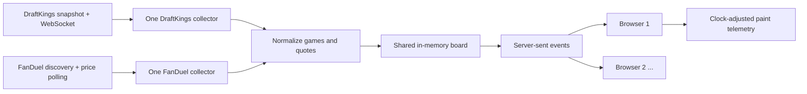

# Fieldline: NFL odds comparison

A small, continuously updating NFL board comparing DraftKings and FanDuel moneyline, spread and total markets. Best Price shows the winner for each **identical point line**, with both books' prices available for comparison. Different lines remain separate. Each source has its own collector and failure state.

## Current status

First local version, October 28, 2026. Both public source integrations work from the development machine in the Toronto area. The app has displayed current odds for 29 DraftKings games and 28 FanDuel games; counts and availability change over time. The default run always fetches actual source data. Test fixtures are never used as a live-data fallback.

GitHub repository: [ali-reza-moradian/fieldline-codex](https://github.com/ali-reza-moradian/fieldline-codex).

**Not yet submission-ready:** public deployment remains outstanding. Actual in-game NFL validation and complete source-to-screen measurement remain outstanding. A connected WebSocket, passing fixture tests, or a fast HTTP request is not proof of measured live-game latency.

## Run locally

Node.js 24 or later:

```sh
npm ci
npm start
# Open http://localhost:3210
```

```sh
npm test          # Offline fixture, matching, recovery-state and HTTP/SSE tests
npm run probe     # Contact both actual sources and report coverage and request time
npm run benchmark -- http://localhost:3210 60
```

`HOST` defaults to `127.0.0.1`; `PORT` defaults to `3210`. Set `HOST=0.0.0.0` in a hosting environment. There are no account credentials or copied browser cookies. `npm start` uses the operating system's certificate authorities; TLS verification remains enabled.

The frontend is plain JavaScript and CSS. The backend uses Node's HTTP server and the `ws` package. There is no build step. The lockfile pins dependency versions.

## Architecture



Run **one application instance** for this version. Collectors start once when the process starts, independently of viewer count. A reconnecting browser receives a complete current snapshot, followed by changed games and source status messages. Updates are serialized once before fanout. Slow viewers with more than 256 KiB queued are disconnected and can reconnect to a fresh snapshot. The prototype caps concurrent streams at 500; this is a protective bound, not a claim of load-tested capacity.

SSE suits a mostly one-way board and provides built-in browser reconnection. The backend uses a WebSocket for DraftKings because that is how its public page receives changes. Keeping these as different transports is intentional. The current board fits in memory; persistence and a database are unnecessary for serving the latest state. Metrics reset on process restart.

## DraftKings acquisition

Region: **Ontario**, as selected by the public site on this development connection.

Chrome DevTools showed an initial `sportscontent/controldata/league/leagueSubcategory/v1/markets` request for NFL league `88808`, main game-lines subcategory `4518`, followed by a subscription to `sportsbook-ws-ca-on.draftkings.com/websocket`.

- Initial full JSON snapshot: events, markets and selections.
- Persistent stream: add/change/remove deltas. Selection changes often omit `marketId` and side, so changes merge into existing objects. Deleting an event removes its markets and selections.
- The browser used MessagePack. Both MessagePack and JSON subscription handshakes were tested. The implemented JSON subscription received real price-only changes and event changes. JSON keeps the partial-update model inspectable and avoids an extra binary-to-domain mapping layer. The larger payload is a tradeoff; no claim is made that JSON is faster than MessagePack.
- Subscribe before fetching the snapshot and buffer updates during acquisition. Apply buffered deltas before publishing the new state. Refresh the snapshot every 60 seconds and after reconnects. The source provides no atomic snapshot/stream cursor in the inspected path, so bootstrap consistency across independently cached snapshot and streaming data is a remaining limitation.
- Ping every 10 seconds; a missed pong triggers reconnect. A source is excluded from best-price calculations after 25 seconds without a connection confirmation, or immediately after a detected failure. A pong confirms the connection, not the age of an unchanged quote.
- Unknown IDs in partial changes trigger a fresh connection and snapshot rather than silently dropping the change. Unexpected message shapes make the source stale.

The stream's literal `default-token` is part of the logged-out public subscription, not a user's JWT. No personal token is stored. Public endpoint paths and client-version fields may change and need maintenance.

## FanDuel acquisition

Region: **New Jersey**, the region used by the observed logged-out page. The region difference from DraftKings is disclosed in the UI. This is a comparison of these specific feeds, not a promise of identical local availability.

The public NFL page first requested `api.sportsbook.fanduel.com/sbapi/content-managed-page` and then repeatedly POSTed discovered market IDs to `smp.nj.sportsbook.fanduel.com/api/sports/fixedodds/readonly/v1/getMarketPrices?priceHistory=0`.

- Refresh discovery every 60 seconds; retain only NFL full-game `MONEY_LINE`, `MATCH_HANDICAP_(2-WAY)` and `TOTAL_POINTS_(OVER/UNDER)` markets.
- The observed pregame browser requested prices approximately every five seconds. The application requests current prices every **two seconds**, in one batch for the discovered markets. Requests never overlap. The smaller price response avoids repeatedly fetching the roughly 1.5 MB decoded content/discovery response.
- Prices are snapshots for the requested IDs. Missing markets are removed instead of being repopulated from stale discovery odds. A response containing none of the requested markets is treated as failure. `inplay`, market suspension and runner status are preserved.
- Polling adds approximately 0–2 seconds of waiting, averaging about 1 second for uniformly timed changes, **before** network and rendering time. This is a model of the polling cost, not a measured source-to-screen result. Retries, caching and outages can exceed that range.
- Failures use exponential backoff with jitter and respect `Retry-After`. The UI immediately marks detected failures stale; a silent source also becomes stale after ten seconds.

No faster NFL push channel was observed in the inspected pregame page. Live NFL network behavior still needs to be checked during an actual game before claiming the same acquisition path is optimal in-game. Discovery failure currently pauses that source's price cycle until retry; separating discovery and price refresh failure handling would improve availability.

## Matching and best price

Normalized quote fields: `gameId`, `book`, `period`, `market`, `side`, `line`, American/decimal odds, source selection ID and suspension state. A separate source-health record tracks confirmation and error state. A price's `changedAt` is when this backend observed it change, not an invented provider timestamp.

Team aliases map to explicit NFL identities. This handles `CAR Panthers` versus `Carolina Panthers`, `NY Jets` versus `New York Jets`, and distinct Rams/Chargers or Giants/Jets identities. Unknown names are reported and excluded rather than guessed.

Game matching uses Toronto calendar date plus away/home team identities. The observed feeds differ by one minute on many kickoffs. Kickoff differences greater than 30 minutes are kept as separate games with a warning. The displayed kickoff favors DraftKings when present. Rescheduled fixtures crossing dates or team orientation changes require more sophisticated matching.

Best price means the highest decimal payout **for the same game, full-game period, side and point line**. American odds are converted to decimal for comparison. Ties show both books. `-3 at -110` and `-3.5 at +100` remain separate contracts; the app does not invent a point-value model to rank them. Stale and suspended offers cannot win. Book-specific views retain stale prices with a clear label.

## Latency: measurements and limits

Initial local observation: **October 28, 2026, 3:43:27–3:44:57 p.m. Toronto time**. The backend and CLI observer ran on the same development machine. These are small, pregame samples, not hosted-service or live-game benchmarks.

The [saved observation report](docs/measurements/initial-pregame.json) contains the sample counts, source health and measured timing distributions.

| Measurement | DraftKings pregame | FanDuel pregame |
| --- | --- | --- |
| HTTP acquisition p50 / p95 | 215.13 / 307.59 ms, n=2 snapshots | 46.92 / 158.18 ms, n=46 price requests |
| Store processing p50 / p95 | 1.20 / 1.74 ms, n=2 | 1.83 / 2.42 ms, n=46 |
| Provider-change → screen | Not established | Not observable from inspected response |
| In-game measurements | Not yet measured | Not yet measured |

No actual price change occurred during that 90-second observation, so it produced **zero stream-change-to-client or browser-paint samples**. Earlier standalone source inspection captured real DraftKings deltas, but those captures do not establish the finished app's end-to-end performance. Repeat the benchmark during actual price movement and from the final hosting location.

A [subsequent local observation](docs/measurements/local-pregame-changes.json), 3:55:08–3:58:40 p.m. Toronto time on the same date, captured two foreground-browser DraftKings price-change samples. Backend receipt to the rendering estimate was 58.15 / 61.15 ms (p50 / p95); the DraftKings feed's `createdTime` to that estimate was 175.15 / 176.15 ms. Reported browser/server clock uncertainty was at least ±0.85 ms, and provider-clock uncertainty remains unmeasured. With only two samples these percentiles are descriptive, not a reliable performance distribution. FanDuel still had no changed-price browser samples, and neither source had in-game samples.

Measurement instrumentation:

1. Record source request duration, response receipt time, decoded bytes and store-processing time.
2. For DraftKings deltas, retain the source's `createdTime` and WebSocket publication time. These are feed timestamps, not verified trading-engine change timestamps. Comparisons with local time depend on clock synchronization.
3. Send receive/send times with each changed-game event. A foreground browser reports an estimate after two animation frames for changed games in view. Five `/api/time` probes select the lowest-RTT clock-offset estimate, refreshed every minute. Half the RTT is reported as a lower bound on timing uncertainty. Two animation frames are a rendering proxy, not hardware display instrumentation.
4. `/api/metrics` returns counts, p50/p95/max and separate pregame/live rows. Client telemetry is diagnostic and client-reported, not trusted billing or security data. The store history is capped at 10,000 updates and browser samples at 5,000.
5. `npm run benchmark -- URL 60` writes a report under ignored `data/`. CLI receive latency is explicitly separate from browser paint latency; remote CLI measurements require synchronized clocks. HTTP acquisition timing is not bookmaker-change latency.

Latency choices: reuse fetch connections; maintain DraftKings' push connection; fetch only main markets; poll FanDuel's price endpoint; send changed games immediately without a debounce window; use one shared collector per book; serialize fanout once. Game-level patches are larger than individual quote deltas but simplify browser consistency. A single region near the observed North American feeds is a sensible first deployment, but placement must be measured, not assumed optimal.

## Access obstacles

- The FanDuel HTML page returned HTTP 403 to a plain server request while the normal browser loaded it. Its public discovery API returned HTTP 400 without the page's `X-Sportsbook-Region: NJ` header and HTTP 200 with it. The price endpoint worked without account cookies.
- DraftKings' HTML loaded directly. Its snapshot endpoint initially timed out or returned HTTP 403 to an incomplete request. A Node request with the public page's ordinary client, origin and region metadata returned HTTP 200. The WebSocket subscription worked without a personal session.
- No CAPTCHA solver, proxy rotation, personal account credentials, TLS-verification bypass or copied anti-bot cookies are used. Actual hosting access is unverified. A successful request from this machine does not prove a cloud host will have access.
- No HTTP 429 was observed during the initial checks; retry behavior is implemented and its delay policy is tested, not claimed as a measured rate-limit recovery incident.

## Deployment

`Dockerfile`, `railway.json` and `render.yaml` are included. For Docker:

```sh
docker build -t fieldline .
docker run --rm -p 3210:3210 fieldline
```

The Docker build has not been executed in the initial local verification. Render is the selected first deployment target, in a dedicated service for this repository. Run one instance. The health check confirms the server is running; inspect both source states and the actual board separately before declaring the integration healthy.

Render settings: build `npm ci --omit=dev`, start `npm start`, `HOST=0.0.0.0`, Node 24+, health path `/healthz`. The included blueprint uses a free service in Ohio; this is deployment preparation, not proof that the region can reach both feeds. The Docker image and `railway.json` remain portable alternatives.

Render's free services can sleep after 15 minutes without inbound traffic and can take about a minute to wake. They can also be suspended for unusually high outbound traffic. These limits affect a continuously ingesting demonstration. Do not present a sleeping free service as an always-on production design. See [Render's free-service limitations](https://render.com/docs/free) and [Node deployment instructions](https://render.com/docs/deploy-node-express-app).

Before submission: deploy, verify both feeds from that host, verify SSE from a separate browser, collect hosted pregame and actual in-game observations, and replace this status section with the verified public app and GitHub URLs.

## With more time

- Verify in-game status, suspension, line changes and discovery behavior during a real NFL game; capture measured latency for both sources.
- Compare MessagePack and JSON empirically, implement the binary mapping if it materially reduces latency/bandwidth, and investigate atomic snapshot/stream versioning.
- Keep last valid discovery while retrying discovery separately; refresh when previously unknown market IDs appear.
- Instrument clock skew, response cache age, true wire bytes and frontend visible-change timings more precisely; export observations to durable storage.
- Add third-book adapters returning the same game/quote model. For multiple serving instances, move collectors into a single owned service (or use leader election) and distribute updates through a broker. Do not simply start duplicate collectors per web replica.
- Add schema-drift alerts and a measured multi-viewer load test. AI can help propose mapping changes, but fixture checks and comparison with source pages must approve them.

## AI assistance

Codex assisted with source investigation, implementation, tests and documentation. Captured source responses and explicit tests ground the integration behavior. The applicant walkthrough and final review are still to be completed; the work should not be represented as unaided.
