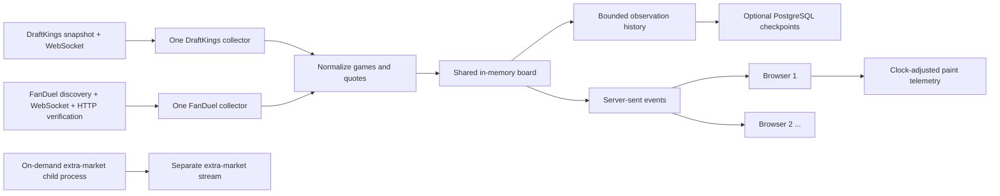

# Fieldline: Ontario football odds comparison

A continuously updating NFL, college football (including FCS), and CFL board comparing DraftKings and FanDuel moneyline, spread and total markets. Best Price shows the winner for each **identical point line**, with both books' prices available for comparison. Different lines remain separate. Both sources use Ontario endpoints. FanDuel keeps an independent verification state for each league; DraftKings rebuilds one complete baseline covering all four source leagues.

Both collectors now target **Ontario**. FanDuel discovery, price requests, push configuration and connection Origin all use the Canadian public site; the UI and health endpoints identify Ontario for both books. There is no fallback to another jurisdiction. Earlier New Jersey observations below are historical and must not be treated as Ontario measurements.

## Current status

Current runtime **`a30a705`** was deployed October 29, 2026, at **8:05:41 p.m. Toronto time**. A live college-game check exposed a parser bug: DraftKings changes its primary market type IDs at kickoff, and the pregame-only map silently dropped those prices while connection health remained green. The fix explicitly recognizes the recorded Ontario live full-game identities, tests kickoff replacement and suspension/reopening, and surfaces unsupported primary-market warnings. Cards now report actual current price coverage per book; missing prices are no longer described as “not offered.”

The [live correction report](docs/measurements/ontario-live-market-fix-20261029.json) retains the failing before-check and all three after-checks: **1,480 prices per round, 4,440 checks, zero missing, extra or mismatched prices** after deployment across NFL, college and CFL. The suite passed **253 tests, none skipped**. A subsequent 60-second college stream delivered actual price changes and spread replacement, with 17 deltas and no observed disconnects. One live moneyline side was absent upstream and correctly stayed blank. This is bounded evidence; it does not establish perpetual accuracy, NFL in-play behavior or absolute bookmaker-to-screen latency.

### Earlier optional-feature verification

Runtime **`4deb501`** was verified on October 29, 2026, at 4:42 p.m. Toronto time. The [deployment check](docs/measurements/extras-persistent-deployment-20261029.json) confirms both Ontario sources, **29 matched games, 348 main-market prices**, 87/87 FanDuel markets, two identical SSE snapshots and all **nine deployed assets**. Fresh independent checks matched **174/174 [DraftKings prices](docs/measurements/extras-persistent-draftkings-main-20261029.json)** and **174/174 [FanDuel prices](docs/measurements/extras-persistent-fanduel-main-20261029.json)** on their first attempts. The [test report](docs/measurements/extras-persistent-test-results-20261029.json) records **223 passed, none skipped**.

The [latest independent extra-market check](docs/measurements/extras-persistent-independent-20261029.json) matched **2,420/2,420 quoted outcomes**, with **zero mismatches on the first attempt**, across Carolina–Green Bay and Baltimore–Buffalo. All seven supported kinds were present at each book for each game. These are fresh, timestamped consistency checks; they do not establish perpetual accuracy or update latency. The [latest restart check](docs/measurements/history-persistent-restart-20261029.json) again preserved all **12 original sampled observations** with separate fresh baselines; storage restored 348 series without rejected rows.

This release keeps the optional DraftKings transport alive across refreshes. In [two completed, stable 60-second windows](docs/measurements/extras-persistent-cloud-comparison-stable-20261029.json), FanDuel completed 238 main-price cycles with extras closed and 235 with two games open: **about 1.27% lower observed polling throughput** when open. Neither window contained a price change. A viewer-count change interrupted the final return-to-closed window, so the full three-window experiment did **not** pass. These results do not prove zero overhead or faster bookmaker-to-screen delivery. Earlier reports and browser-check scope below remain identified by their own versions.

### Intermediate optional-feature verification

Runtime **`b14c22f`** was verified on October 29, 2026, at 4:24 p.m. Toronto time. The [final deployment check](docs/measurements/extras-final-deployment-20261029.json) confirms both Ontario sources, **29 matched games, 348 main-market prices**, 87/87 FanDuel markets, two identical SSE viewer snapshots and all **nine deployed assets**. Fresh independent checks matched **174/174 [DraftKings prices](docs/measurements/extras-final-draftkings-main-20261029.json)** and **174/174 [FanDuel prices](docs/measurements/extras-final-fanduel-main-20261029.json)** on their first attempts. The final suite passed **212 tests, none skipped**.

The [independent extra-market check](docs/measurements/extras-final-independent-20261029.json) matched **2,423/2,423 quoted outcomes**, with **zero mismatches on the first attempt**, across Carolina–Green Bay and Baltimore–Buffalo. Each book returned all seven supported kinds for each game: alternate spreads, alternate totals, touchdowns, passing yards, rushing yards, receiving yards and receptions. The verifier separately read the public Ontario source responses; its development-machine reads were validation only and supplied no prices to the cloud app. These timestamped comparisons establish observed consistency, not perpetual correctness or update latency.

The [history restart check](docs/measurements/history-restart-20261029.json) preserved **12/12 sampled price points** and established separate fresh baselines after deployment. Public desktop controls were checked on `b14c22f`. The 375px board check belongs to the earlier `8f0148c` release; its CSS is unchanged in `b14c22f`, but this is not a claim that every mobile control or browser was retested. This is the intermediate release: its [controlled cloud comparison](docs/measurements/extras-final-cloud-comparison-20261029.json) is retained alongside the newer persistent-session work. No speed advantage is claimed from the feature list or accuracy checks.

### Earlier stream-recovery verification

Runtime **`2bffe9c`** was verified on October 29, 2026, at 11:44 a.m. Toronto time. It adds silent-stream recovery, compact source confirmations and bounded clock checks. The [deployment report](docs/measurements/render-stream-recovery-deployment-verification.json) verifies both Ontario sources, 29 matched games, all 348 prices, 87/87 FanDuel markets, two identical viewer snapshots and all six frontend assets. Fresh independent checks matched **174/174 [DraftKings quotes](docs/measurements/render-stream-recovery-draftkings-source-verification.json)** and **174/174 [FanDuel quotes](docs/measurements/render-stream-recovery-fanduel-source-verification.json)** on their first attempts. That release passed **106 tests, none skipped**, including silent connections, delayed messages, browser API compatibility, source failures, slow viewers and compact-message ordering. [Browser fault checks](docs/measurements/ui-stream-recovery-verification.json) verified Chrome recovery to a fresh baseline and stale-source exclusion; the public FanDuel and Best Price views were checked after deployment.

A [60-second public observation](docs/measurements/render-stream-recovery-observation.json) received 218 compact confirmations and 30 heartbeats, averaging about **1,002 SSE application bytes/second** after the initial snapshot. The longest observed receive gap was 704 ms. Across the surrounding metadata interval, 239 complete FanDuel checks succeeded with no failures, partial responses or rate limits. No prices changed during this window, so it establishes neither changed-price latency nor superiority over another implementation. The earlier delivery gap below remains historical evidence; the recovery mechanism does not identify or prove elimination of its underlying cause.

### Previous observations

The UI and faster complete-price checks were deployed on October 28, 2026, at about 11:11 p.m. Toronto time, as runtime **`1365228`**. The [deployment verification](docs/measurements/render-ui-speed-deployment-verification.json) confirms both Ontario sources are ready, 29 matched games, 174 prices per book, 87/87 FanDuel markets, all push subscriptions acknowledged, and the configured **250 ms** HTTP interval. Two independent SSE viewers received identical boards, and all five frontend assets matched the committed files. The public page was checked again in Chrome after deployment.

Fresh independent checks matched **174/174 [FanDuel quotes](docs/measurements/render-ui-speed-fanduel-source-verification.json)** and **174/174 [DraftKings quotes](docs/measurements/render-ui-speed-draftkings-source-verification.json)** on their first attempts, with no missing, extra or mismatched quote values. Both checks independently join source selections to teams, sides, markets and point lines. The displayed kickoff uses DraftKings; the FanDuel report separately lists 27 one-minute differences and one four-minute difference between the sources. The final local suite passed **86/86 tests, none skipped**. These are observed checks, not a guarantee of perpetual accuracy.

The [quarter-second cloud observation](docs/measurements/render-ui-speed-pregame-observation.json) records two fixed five-minute pregame windows, 11:12–11:17 p.m. and 11:19–11:24 p.m. Toronto time. Across the longer baseline/grace metadata spans, **2,532 complete FanDuel cycles succeeded**, with zero failed, partial or rate-limited cycles. No actual price changes occurred, so these runs establish no changed-price latency. A 14.462-second delivery gap began near the end of the first window and ended during grace; server timestamps and advancing cycle counts show collection continued, with status messages arriving later in a burst. The precise delivery layer is unresolved. Reported source health must not be read as a guarantee of uninterrupted low-latency delivery.

The earlier Ontario migration was deployed October 28, 2026, with **both sportsbooks using Ontario**. The [Ontario deployment check](docs/measurements/render-ontario-deployment-verification.json), at 8:37 p.m. Toronto time, verifies runtime `f8650e6`, 29 matched games and **174 prices per book**. Both independent SSE clients received the same board; all four served frontend assets matched the committed files. FanDuel returned all 87 markets in two bounded batches and acknowledged every Ontario push subscription.

Independent source checks matched **174/174 [FanDuel quotes](docs/measurements/render-ontario-source-verification.json)** and **174/174 [DraftKings quotes](docs/measurements/render-ontario-draftkings-source-verification.json)** against fresh official Ontario responses, including sides, point lines, prices and suspension. The comparisons read source fields independently of the app's normalizers; neither reported missing, extra or mismatched quotes. The migration passed **65 automated tests, none skipped**. These are bounded checks of observed data and failure handling, not a promise of perpetual accuracy.

A later [Ontario push observation](docs/measurements/render-ontario-first-push.json) on runtime `f8650e6` captured **two actual FanDuel market-price pushes** reaching the public stream. Carolina at Green Bay's home moneyline moved from −190 to −200 and its away moneyline from +160 to +168. This verifies Ontario changed-price delivery through push, beyond subscription acknowledgement. It remains a two-update pregame sample on one game, without browser-paint or absolute bookmaker-change timing.

The reloaded public page was also checked in Chrome: Ontario labels and policy, all three source views, search, all six prices for Carolina at Green Bay, Best Price winners and separation of different point lines. Clearing the search restored all 29 matched games. This is interface verification, not a changed-price rendering measurement.

The default run always fetches actual source data; test fixtures are never used as a live-data fallback. The previous 28-game / 160-price result was a silent response-truncation bug, not unavailable markets. Before the Ontario migration, the New Jersey cloud runtime delivered an actual FanDuel moneyline change through push and a total change through HTTP. That historical observation establishes neither Ontario push latency nor live-game performance.

Public app: [fieldline-codex.onrender.com](https://fieldline-codex.onrender.com).
GitHub repository: [ali-reza-moradian/fieldline-codex](https://github.com/ali-reza-moradian/fieldline-codex).

**Both sources now work fully in the cloud on Render.** The public board was checked with 29 DraftKings games, 29 FanDuel games and 29 matched games, with 174 prices per book. DraftKings' snapshot returned HTTP 403 through Node's HTTP client on this host. A browser-compatible TLS/HTTP client fetched the same public snapshot successfully from the same Render runtime; the native Node WebSocket supplies subsequent changes. The collector needs no development-machine relay or personal sportsbook session. The historical failure reports below are retained as evidence of the investigation.

**Still required before claiming the whole brief is verified:** actual in-game NFL validation and complete per-source change-to-screen measurement. A connected WebSocket, passing fixture tests, or a fast HTTP request is not proof of measured live-game latency. The host's free-tier sleep behavior also applies.

The [pre-migration deployment check](docs/measurements/render-fanduel-push-hedged-verification.json), at 8:02 p.m. Toronto time on October 28, confirms runtime commit `0b35780`, ready status, complete market coverage, FanDuel's acknowledged New Jersey push connection and its parallel one-second HTTP checks after a fresh deployment. Two independent HTTP stream clients received the same 29-game board revision with 29 matched games; all four served frontend assets matched the committed files. The earlier [push deployment](docs/measurements/render-fanduel-push-verification.json) and [restart check](docs/measurements/render-restart-verification.json) are retained as historical evidence. The temporary access-diagnostic output has been removed from the production response.

See the [plain-English walkthrough](docs/walkthrough.md) for the design, a demo sequence and questions to practice.

## League selection and delivery

Use the League menu, or `?league=nfl`, `?league=ncaaf`, and `?league=cfl`. `/api/board`, `/api/events`, and `/api/health` accept the same parameter and default to NFL. Each stream starts from a complete selected-league snapshot. A league switch closes the previous stream and starts a fresh baseline; unrelated prices and chart state cannot leak into the next league.

FanDuel keeps NFL checks at 250 ms. College and CFL share a bounded auxiliary request queue, normally every 2 seconds and every 1 second when a game is live. Each league has its own complete-price lease and push subscriptions. A shared price-endpoint rate limit pauses all queues; it is never bypassed by switching leagues. Quiet checks avoid rebuilding unchanged boards.

HTML, scripts, styles and JSON responses support gzip. Static files are cached in memory and revalidated with representation-specific ETags; live JSON remains `no-store`. Streaming changes are sent immediately without compression buffering. The browser retries an isolated stream disconnect after 250 ms, with exponential backoff on repeated failures. DraftKings also retries its first isolated connection loss promptly, and remains stale until a complete baseline has been rebuilt.

## Run locally

Node.js 24 or later:

```sh
npm ci
npm start
# Open http://localhost:3210
```

```sh
npm test          # Offline fixture, matching, recovery-state and HTTP/SSE tests
npm run probe     # Contact both actual sources and report coverage and request time
npm run diagnose  # Bounded DraftKings access and public regional-configuration checks
npm run benchmark -- http://localhost:3210 60
```

`HOST` defaults to `127.0.0.1`; `PORT` defaults to `3210`. Set `HOST=0.0.0.0` in a hosting environment. Sportsbook collection needs no account credentials or copied browser cookies. Optional history persistence uses a server-only database connection string; see `.env.example` and the deployment section. `npm start` uses the operating system's certificate authorities; TLS verification remains enabled.

The frontend is plain JavaScript and CSS. The backend uses Node's HTTP server and the `ws` package. On Render, a small Python subprocess using pinned `curl_cffi` fetches DraftKings' initial and periodic HTTP snapshots. Streaming updates stay in Node. There is no frontend build step.

Render installs the optional Python transport automatically during `npm ci` into an isolated `.venv`. To use the same transport locally, install Python 3.10+ and run:

```sh
INSTALL_CURL_TRANSPORT=1 npm ci
DK_HTTP_TRANSPORT=curl npm start
npm test
```

`DK_HTTP_TRANSPORT=native` selects Node's HTTP client; `curl` selects the compatible client. Render defaults to `curl`; other native Node installations default to `native`. The current `4deb501` suite passed **223 tests, with none skipped**; see the [test report](docs/measurements/extras-persistent-test-results-20261029.json). The earlier 212-test batch-transport, 106-test stream-recovery and 65-test Ontario migration counts are historical. Run `npm test` to reproduce the current suite. The optional HTTP integration test runs when `.venv` is installed; otherwise it is explicitly skipped. Tests cover real local HTTP/WebSocket servers, every captured Ontario price and side/line mapping, regional configuration isolation, complete multi-batch acquisition, rate limits, cancellation, subscription expiry, reconnect baselines, push/poll ordering, quarter-second scheduling, stale-data handling, multiple viewers, presentation/history rules and the independent comparison harness. They do not contact bookmakers. The [manual UI replay check](docs/measurements/ui-movement-verification.json) additionally records desktop and 375px responsive checks of arrows, line changes, pauses, stale sources, reconnects and history.

## Architecture



Run **one application instance** for this version. Collectors start once when the process starts, independently of viewer count. A reconnecting browser receives a complete current snapshot, followed by changed games and source status messages. Updates are serialized once per selected league before fanout. Each league receives only its own games and source verification state. Slow viewers have a bounded queue: at least 256 KiB, or their initial snapshot plus 64 KiB, capped at 1 MiB. Exceeding that bound disconnects the stream so it can recover with a fresh snapshot. The prototype caps concurrent streams at 500; this is a protective bound, not a claim of load-tested capacity.

Price changes and changes to source eligibility are sent immediately. Repeated timestamp confirmations use compact `freshness` messages, at most four per second; full diagnostics remain in snapshots and `/api/metrics`. A controlled 50-cycle test reduced routine SSE application bytes from 70,659 to 12,448 (82.4%), excluding identical initial snapshots. This measures traffic saved, not changed-price latency.

The browser owns reconnection with 1–15 second backoff. An observable heartbeat every two seconds confirms transport only; it never makes a sportsbook healthy. After 12 seconds without a valid message, or without an initial snapshot, the browser closes the old connection and requires a fresh full snapshot. It also checks when a hidden tab returns. Browser timer suspension can delay background detection; these intervals are not wall-clock guarantees while the browser is suspended. Generation guards reject callbacks from old connections, calibrated checks reject substantially delayed frames, and history leaves gaps across outages. Clock requests have four-second timeouts and one synchronization in flight; calibration uses monotonic time and expires after two minutes.

SSE suits a mostly one-way board. The backend uses each book's own public WebSocket price feed. The current board stays in memory and is rebuilt from the books after a restart. Optional PostgreSQL storage preserves historical observations only; it never restores live-price eligibility. History and extra-market failures do not change the main-source readiness calculation. Metrics reset on process restart.

## DraftKings acquisition

Region: **Ontario**, as selected by the public site on this development connection.

Chrome DevTools showed an initial `sportscontent/controldata/league/leagueSubcategory/v1/markets` request for NFL league `88808`, main game-lines subcategory `4518`, followed by a subscription to `sportsbook-ws-ca-on.draftkings.com/websocket`.

- Initial full JSON snapshot: events, markets and selections.
- Persistent stream: add/change/remove deltas. Selection changes often omit `marketId` and side, so changes merge into existing objects. Deleting an event removes its markets and selections.
- The browser used MessagePack. Both MessagePack and JSON subscription handshakes were tested. The implemented JSON subscription received real price-only changes and event changes. JSON keeps the partial-update model inspectable and avoids an extra binary-to-domain mapping layer. The larger payload is a tradeoff; no claim is made that JSON is faster than MessagePack.
- Subscribe before fetching the snapshot and buffer updates during acquisition. Apply buffered deltas before publishing the new state. Refresh the snapshot every 60 seconds and after reconnects. During a periodic refresh, continue applying incoming stream changes to the current board while also buffering them for the replacement snapshot; a slow HTTP refresh must not hold up current prices. The source provides no atomic snapshot/stream cursor in the inspected path, so bootstrap consistency across independently cached snapshot and streaming data is a remaining limitation.
- Ping every 10 seconds; a missed pong triggers reconnect. A source is excluded from best-price calculations after 25 seconds without a connection confirmation, or immediately after a detected failure. A pong confirms the connection, not the age of an unchanged quote.
- Unknown IDs in partial changes trigger a fresh connection and snapshot rather than silently dropping the change. Unexpected message shapes make the source stale.

The stream's literal `default-token` is part of the logged-out public subscription, not a user's JWT. No personal token is stored. Public endpoint paths and client-version fields may change and need maintenance.

On Render, the main-market snapshot subprocess uses the Chrome TLS/HTTP profile supplied by pinned [`curl_cffi`](https://curl-cffi.readthedocs.io/en/latest/impersonate/_index.html). The collector owns one persistent anonymous session, verifies certificates, and caps each complete batch at 8 MiB. Four verified league endpoints are merged atomically; a missing or failed response cannot become an empty healthy league. Node imposes a 15-second outer deadline. Aborting a request, timing out, or stopping the collector retires the worker. HTTP status and `Retry-After` feed the source retry policy. Warm refreshes reuse the process and connections; startup measurements are reported separately. The continuous WebSocket path avoids this subprocess cost on each price change. No logged-in session or expiring copied browser cookie is required.

## FanDuel acquisition

Region: **Ontario**, matching DraftKings. The original implementation used the New Jersey feed observed in the initial investigation; that was an implementation choice, not a requirement of the brief. The current integration uses the distinct Canadian endpoints, public push configuration, Origin and market catalogue together. Market IDs are discovered afresh; New Jersey IDs and prices are not reused.

The Canadian public app provides discovery through `sbapi.on.sportsbook.fanduel.ca/api/content-managed-page`, HTTP price snapshots through `smp.on.sportsbook.fanduel.ca/api/sports/fixedodds/readonly/v1/getMarketPrices?priceHistory=0`, and sportsbook market-price push through `pir.on.sportsbook.fanduel.ca/graphql/realtime`. The current production web bundle independently confirms the separate Canadian `PIR_AUTH_KEY` configuration and `OnUpdateMarketPrice` subscription, including main-market runner prices, suspension, in-play status and `updatedAt`. A missing or mismatched Canadian configuration degrades push and leaves Ontario polling active; it does not substitute a US feed.

- Refresh discovery every 60 seconds; retain only supported full-game `MONEY_LINE`, `MATCH_HANDICAP_(2-WAY)` and `TOTAL_POINTS_(OVER/UNDER)` markets. Discovery failure retains the last valid catalogue while price updates continue, with a separate bounded retry. Unknown-market push messages can request rediscovery without postponing regular price checks or overriding the discovery endpoint's Retry-After deadline.
- Fetch HTTP prices in batches of at most **70 market IDs**, with at most two requests in flight. A direct check requested 87 together and received only 80; 70+17 returned all 87, including seven open markets previously omitted. A failed batch aborts its sibling and cannot replace the board with a partial result. Successful omissions are exposed as incomplete coverage, and omitted prices are removed rather than filled from old discovery data.
- Discover the public AppSync client configuration from the current Canadian FanDuel app shell and bundle, validate its Canadian endpoint, and send the Canadian Origin. It is page configuration, not a sportsbook-account credential. The collector refreshes it after rejection with bounded retries; no personal login, cookie or fixed copied key is required.
- Subscribe to all discovered markets and wait for every acknowledgement. Establish a complete fresh HTTP baseline after connecting/reconnecting. Push prices are then normalized and sent immediately, with no batching timer. An acknowledged socket is not treated as an initial price snapshot.
- Run HTTP checks every **250 ms alongside push** by default, continuing the same polling path if push fails. `FD_POLL_MS` can select a slower interval; values below 250 ms are clamped. A healthy push feed can still lag a change, so its acknowledgement does not slow HTTP verification. Nominal polling wait averages about 125 ms only for uniformly timed changes without delays; it is not a maximum price age or measured end-to-end latency. The scheduler accounts for request duration, allows only one complete cycle in flight and does not accumulate catch-up requests. At 87 markets each cycle makes two bounded concurrent HTTP requests: up to eight requests per second during regular successful polling, compared with two at the previous one-second interval. Slower responses reduce the rate; failures retain at least a one-second retry base and honor longer Retry-After instructions. Cumulative successful, failed, partial and rate-limited cycle counts remain visible under `sources.fanduel.channels.polling`; deployment verification records the initial cloud result. A healthy short observation does not guarantee future rate-limit behavior.
- Keep applying pushes while HTTP is in flight. A push received after a poll starts wins over that poll's result. An HTTP request started after the latest push may advance prices immediately; there is no arbitrary push-priority hold. Strictly older push timestamps are rejected; distinct updates in the same source second retain receive order. HTTP has no shared version cursor and push timestamps are coarse, so perfect cross-channel ordering cannot be proven: a cached HTTP response or a late push may still temporarily regress a price. Periodic reconciliation, counters and explicit freshness limits make this tradeoff observable.
- Monitor both TCP connectivity and AppSync protocol keepalives. Subscription errors, malformed requested data and missed deadlines trigger reconnect and fallback. A transient HTTP failure does not interrupt a verified push stream; after **30 seconds without a complete HTTP verification**, the full-board freshness lease expires. Partial responses cannot renew it. HTTP retries honor `Retry-After` and exponential backoff.

`/api/metrics` exposes push state, acknowledgements, reconnects, accepted/duplicate/out-of-order updates, prevented polling overwrites, per-channel errors and requested/returned coverage. `/api/health` checks league-wide collector readiness: both sources must be fresh, populated and have complete required response coverage. It does not establish that every discovered game has all six main prices; per-game current-price coverage is shown separately in the UI. `/healthz` remains process liveness, so one bookmaker outage does not restart the working source.

## Matching and best price

Normalized quote fields: `gameId`, `book`, `period`, `market`, `side`, `line`, American/decimal odds, source selection ID and suspension state. A separate source-health record tracks confirmation and error state. A price's `changedAt` is when this backend observed it change, not an invented provider timestamp.

Team aliases map to explicit league-specific identities. NFL game IDs remain stable; college and CFL IDs include their league. A checked catalog covers observed college programs and rejects ambiguous names such as Miami without its state. Unknown future programs remain excluded with a warning until their identities are verified. NFL aliases use explicit identities. This handles `CAR Panthers` versus `Carolina Panthers`, `NY Jets` versus `New York Jets`, and distinct Rams/Chargers or Giants/Jets identities. Unknown names are reported and excluded rather than guessed.

Game matching uses Toronto calendar date plus away/home team identities. The observed feeds differ by one minute on many kickoffs. Kickoff differences greater than 30 minutes are kept as separate games with a warning. The displayed kickoff favors DraftKings when present. Rescheduled fixtures crossing dates or team orientation changes require more sophisticated matching.

Best price means the highest decimal payout **for the same game, full-game period, side and point line**. American odds are converted to decimal for comparison. Ties show both books. `-3 at -110` and `-3.5 at +100` remain separate contracts; the app does not invent a point-value model to rank them. Stale and suspended offers cannot win. Book-specific views retain stale prices with a clear label.

## Board controls and optional features

The responsive board keeps source health, Ontario labels and comparison policy visible. Choose Best Price, DraftKings or FanDuel; filter by team or game status; and switch between American and decimal odds. Decimal prices display to three places, while ranking uses the original precision. View and format are shareable through the URL, for example `/?view=fanduel&odds=decimal`.

Eight optional feature groups are implemented:

- Alternate spreads and totals, opened through **More markets**.
- Player props: touchdowns, passing yards, rushing yards, receiving yards and receptions where offered. Supported player ladders preserve inclusive **N+** thresholds; this is not a claim to support every ordinary over/under market.
- Starred games, saved in this browser and sorted first.
- Comfortable and compact density.
- Light and dark themes.
- Board and comparison-grid layouts.
- Keyboard shortcuts, with help in the UI and typing-safe handling.
- Main-market implied margin, arbitrage candidates, market-derived fair probability and estimated EV, with margin/EV sorting.

Extra-market scope remains NFL. College and CFL currently provide moneyline, spread and total game lines. Extra-market comparisons require the same game, player or team, side, line and settlement contract. Different house protection or early-exit rules remain separate and are not ranked against each other. Analytics require fresh, active, complete two-sided prices from both books on the same contract. Fair probabilities normalize each book's implied probabilities and average the books; estimated EV is conditional on a settled win/loss and is **not an independently predictive model**. Push, tie-void and cancellation probabilities are not modeled. An arbitrage flag identifies observed-price candidates, not guaranteed executable profit.

Extra markets run only while requested, in a separate cloud child process and stream. Viewers share work for the same game; at most **two games** are collected concurrently across viewers. The nominal refresh interval is **15 seconds**, with exclusion after **45 seconds** without confirmation. Failures and capacity limits are shown in the panel and do not make the main feed unhealthy. Main DraftKings/FanDuel push behavior and FanDuel's **250 ms** parallel HTTP checks remain unchanged. DraftKings retrieves its seven supported categories sequentially through a bounded anonymous `curl_cffi` session owned by the extra-market worker. The Python process and TLS-verified session are reused across the 15-second refresh cycles. Cancellation retires the process and session, worker shutdown closes them, and 60 seconds of transport inactivity releases them; a later request creates a new session. The batch remains limited to seven categories, 8 MiB total decoded data and a 30-second outer deadline. It publishes only after every requested category succeeds and passes identity, coverage and timestamp validation; a failed or incomplete batch cannot refresh old prices. This optional transport does not change the main snapshot or push collector. Process isolation still shares the host's CPU and network resources.

The [earlier two-game observation](docs/measurements/extras-loaded-cloud-observation-20261029.json) on `8f0148c` exposed that cost: FanDuel completed **203 main-price cycles in 60 seconds**, and DraftKings extra-market requests took about **13–17 seconds**. That implementation started a separate Python request for every category. The result is preserved as evidence of the problem that prompted batching. It was a quiet-price, extras-enabled observation, not a controlled comparison or a changed-price latency measurement. The [intermediate `b14c22f` comparison](docs/measurements/extras-final-cloud-comparison-20261029.json) then measured the single-batch design. The current worker-owned session removes Python startup between refreshes; its bounded measurements and their limits follow.

A [one-minute loaded observation](docs/measurements/extras-persistent-loaded-20261029.json) on `4deb501` recorded **236 successful main FanDuel cycles over a 60.164-second metrics span**, with no failed, partial or rate-limited cycles. Two extra-market games produced **16 updates**, with no extra-market errors or worker restarts. Eight DraftKings category-batch requests took **1.09–1.89 seconds**; eight FanDuel extra-price reads took **75–197 ms**. A history checkpoint advanced, with 348 saved/restored series reported. This establishes observed acquisition times and availability under load. Viewer counts were not fixed and no main prices changed, so it is not a causal overhead comparison or changed-price latency result.

The [first controlled attempt](docs/measurements/extras-persistent-cloud-comparison-20261029.json) and [second attempt](docs/measurements/extras-persistent-cloud-comparison-retry-20261029.json) were invalidated when the main viewer count changed from three to four. Those reports are preserved and excluded from overhead conclusions; the invalidation was an experiment-condition change, not a recorded app failure.

The [third controlled attempt](docs/measurements/extras-persistent-cloud-comparison-stable-20261029.json) completed two windows with stable viewers, source health and workload on the same `4deb501` process:

| Completed window | Successful main FanDuel cycles | Metrics span | Cycles/second |
| --- | ---: | ---: | ---: |
| Extras closed | 238 | 60.101 s | 3.9600 |
| Two extra-market games open | 235 | 60.107 s | 3.9097 |

The open window's observed throughput was **1.27% lower**. Its eight DraftKings batches averaged **1.070 s**, with **1.498 s p95**; eight FanDuel extra reads averaged **117.69 ms**, with **191.45 ms p95**. The completed windows recorded no source errors, partial or rate-limited main FanDuel cycles, and **zero changed-price events**. The final closed window was interrupted by another viewer increase from three to four, leaving the full experiment's `pass` field **false**. Only the two completed windows are summarized here. All three unsuccessful full attempts remain saved; the final-window invalidation is not evidence of an app outage. Sequential windows cannot isolate upstream/network variation, so the small observed difference must not be presented as zero overhead, a proven causal slowdown or faster odds-change delivery.

Movement cues use transitions actually observed by this tab. A higher/lower payout gets an up/down arrow and its previous price for eight seconds. Negative American prices and transitions across zero are compared by decimal payout; −100 and +100 are equivalent. Changed point lines, suspension and reopening are separate events. Recent moves remain tab-local: they retain 30 transitions, show the latest eight for the selected source view, and reset on reload.

## Retained price history

Select a price or **Price history** to request server observations for that game/market/side. One open chart is drawn at a time. It shows up to **48 hours**, bounded to **3,000 points per book/game/market/side series**, **4,096 series** and **150,000 points globally**. Startup, retention and capacity eviction can shorten the available window. There is no backfill of unobserved sportsbook history. A labeled current-tab history may appear while the server request loads.

Charts use actual server observation times and decimal prices, not verified trading-engine change times. Source failures, stale periods, suspensions, removals and changed point lines break continuity; the next eligible observation starts a new baseline. The chart never extends an old price to the present or fills an outage with invented points. A browser reconnect reloads available server history; movements missed by that browser are not invented in its Recent moves list. History requests add no sportsbook polling.

History processing is deferred from main-message fanout and bounded; overload leaves a visible gap. Optional PostgreSQL checkpoints run asynchronously every **60 seconds**, serializing and restoring one bounded series at a time. Restoration merges older points without replacing newer in-memory observations or making a source healthy. A crash can lose observations since the last successful checkpoint: the nominal 60-second cadence plus checkpoint duration, and longer during storage outages. Failed or unconfigured storage leaves in-memory history working, with its limitation shown in the chart. Check `/api/history` storage status and `/api/metrics` for actual availability.

The [October 29 restart check](docs/measurements/history-restart-20261029.json) verified persistence from runtime `8f0148c` to `b14c22f`: **12/12 sampled prices**, covering all six main selections at both books for Baltimore–Buffalo, retained their exact observation times and values. Each series also established a separate fresh baseline after restart. Storage reported 348 restored series, 348 saved series and no rejected rows. The [subsequent `4deb501` restart check](docs/measurements/history-persistent-restart-20261029.json) again found all 12 original sampled points, separate fresh baselines and 348 restored series without rejected rows. These checks prove sampled observations survived the recorded restarts; **48 hours is the retention ceiling**, not a claim that 48 elapsed hours of history have been collected or verified.

Price updates replace only affected game markup and preserve the focused control. Status-only updates refresh source cards unless eligibility changes. Changed-price telemetry still runs after two animation frames for visible games, with clock uncertainty reported separately. Tests and browser replay checks do not establish production or live-game latency.

## Latency: measurements and limits

The [first observed Ontario FanDuel pushes](docs/measurements/render-ontario-first-push.json) were recorded during **10:21:17–10:26:17 p.m. Toronto time on October 28**, on runtime `f8650e6` with the then-current one-second HTTP checks. Two moneyline updates for Carolina at Green Bay reached the public SSE stream through `kind: push`: home −190 → −200 and away +160 → +168. Store processing took **2.12 ms** and **4.82 ms** respectively; the source accepted two market frames with no reconnect, authentication error or malformed frame. These are two correlated pregame updates on one game, not an end-to-end latency distribution. FanDuel's timestamp has whole-second precision and unknown clock skew. This report does not measure browser paint or the newer quarter-second HTTP cadence.

The earlier [New Jersey FanDuel cloud changes](docs/measurements/render-first-fanduel-changes.json) arrived at 8:06:33–8:06:34 p.m. Toronto time on October 28, during a five-minute public SSE observation of runtime `0b35780`. Atlanta at Tampa Bay's total changed from 45.5 to 44.5 through HTTP first; its moneyline then changed from home -138 / away +118 to -136 / +116 through push. These were **two correlated messages, four quote transitions, one pregame game**. Store processing took **1.17 ms** for the HTTP change and **1.75 ms** for the push change. Two actual market push messages were accepted; the pushed total arrived after HTTP and caused no additional quote change. No reconnect, authentication error or malformed frame occurred. This establishes actual push delivery through the deployed collector and public stream. It is not a measured bookmaker-change-to-screen or in-game latency result; the observer's wall clock is not calibrated in that report, and FanDuel's source timestamp is coarse.

The [final one-second-check observation](docs/measurements/render-final-pregame-observation.json), 8:03:10–8:06:11 p.m. Toronto time on October 28, observed runtime `0b35780` for 180 seconds. Both sources were healthy and complete at the end, with FanDuel push still verified and no reconnects. No actual price-change event reached the observer in this window. Since that process started, 327 FanDuel acquisition cycles had request p50/p95 **17.10/108.96 ms** and store-processing p50/p95 **1.68/3.12 ms**. These are HTTP-cycle and processing measurements, not bookmaker-change-to-screen latency. Push handling is covered by the local wire/integration tests; an actual FanDuel price push and in-game timing remain unobserved in these quiet windows.

The [first push-enabled Render observation](docs/measurements/render-push-pregame-observation.json), 7:51:45–7:54:45 p.m. Toronto time on October 28, ran for 180 seconds after deployment of `7c7cbfb`. Both books remained populated with 29 games and 174 prices, and FanDuel retained its verified 87-market subscription without a reconnect. The observer received **zero changed-price events**, so this run establishes neither per-book delivery latency nor browser-rendering latency. The source request and processing metrics in the report are accumulated since process startup, not solely during the observation window. This first observation used five-second HTTP verification, subsequently shortened to one second so HTTP can compete with a healthy-but-late push feed. The earlier measurements below predate FanDuel push and the coverage fix.

Initial local observation: **October 28, 2026, 3:43:27–3:44:57 p.m. Toronto time**. The backend and CLI observer ran on the same development machine. These are small, pregame samples, not hosted-service or live-game benchmarks.

The [saved observation report](docs/measurements/initial-pregame.json) contains the sample counts, source health and measured timing distributions.

| Measurement | DraftKings pregame | FanDuel pregame |
| --- | --- | --- |
| HTTP acquisition p50 / p95 | 215.13 / 307.59 ms, n=2 snapshots | 46.92 / 158.18 ms, n=46 price requests |
| Store processing p50 / p95 | 1.20 / 1.74 ms, n=2 | 1.83 / 2.42 ms, n=46 |
| Provider-change → screen | Not established | Not observable from inspected response |
| In-game measurements | Not yet measured | Not yet measured |

No actual price change occurred during that 90-second observation, so it produced **zero stream-change-to-client or browser-paint samples**. Earlier standalone source inspection captured real DraftKings deltas, but those captures do not establish the finished app's end-to-end performance. Repeat the benchmark during actual price movement and from the final hosting location.

A [subsequent local observation](docs/measurements/local-pregame-changes.json), 3:55:08–3:58:40 p.m. Toronto time on the same date, captured two foreground-browser DraftKings price-change samples. Backend receipt to the rendering estimate was 58.15 / 61.15 ms (p50 / p95); the DraftKings feed's `createdTime` to that estimate was 175.15 / 176.15 ms. Reported browser/server clock uncertainty was at least ±0.85 ms, and provider-clock uncertainty remains unmeasured. With only two samples these percentiles are descriptive, not a reliable performance distribution. FanDuel still had no changed-price browser samples, and neither source had in-game samples.

A [Render observation](docs/measurements/render-access-check.json) saved at 4:59:29 p.m. Toronto time records FanDuel request p50 / p95 of **16.38 / 30.56 ms** and processing p50 / p95 of **1.28 / 2.46 ms**, with 207 samples accumulated since the process started at 4:52:36 p.m. The separate CLI observation ran from 4:58:29 to 4:59:29 p.m. and received no changed-price events. DraftKings had zero hosted acquisition samples because its snapshot was denied. These figures measure FanDuel request/processing time, not source-change-to-screen latency.

A [Fly Toronto observation](docs/measurements/fly-access-check.json) at 6:15:47 p.m. records 21 FanDuel pregame price requests after a cold start: request p50 / p95 **39.59 / 77.72 ms**, processing **1.81 / 4.02 ms**. Two HTTP stream clients each received a snapshot containing 28 games. DraftKings again had zero valid acquisition samples. No changed-price rendering or in-game samples were captured. The trial Machine stopped five minutes after its first start and woke for a subsequent request; the saved report separates the initial empty cold-start state from the populated board.

The [first working two-source Render observation](docs/measurements/render-two-source-pregame.json), 6:35:16–6:37:16 p.m., received **two actual DraftKings price-change events** through the public SSE stream. Both sources remained healthy with 29/28 games. Backend metrics accumulated since startup included four DraftKings snapshots (acquisition p50/p95 1,612.04/6,206.23 ms, including Python startup and a cold first acquisition) and 96 FanDuel requests (16.66/92.08 ms). No FanDuel price change occurred in that observation. The remote CLI's uncalibrated clock produced negative backend-to-client values; those latency values are invalid and are retained only as diagnostic evidence. The benchmark now calibrates its clock against `/api/time` before observing. Neither browser-paint nor live-game latency was established by this run. The subsequent refresh fix prevents slow snapshots from delaying incoming stream prices.

After the final restart, a [calibrated Render observation](docs/measurements/render-calibrated-pregame.json), 6:42:56–6:44:56 p.m., received another two DraftKings changed-price events. Estimated backend receipt → remote CLI delivery was **69.75 / 72.75 ms** (p50/p95, n=2), with a minimum clock uncertainty of **±25.25 ms**. Feed-created → CLI was 478.75 ms for both samples, with additional unknown provider-clock skew. These are small CLI samples, not browser-paint or in-game measurements. FanDuel remained healthy, but no changed-price event occurred in that window. The saved backend metrics include 101 FanDuel requests since restart (16.95/98.76 ms p50/p95); neither source produced a hosted browser-render sample in this observation.

The [Ontario cloud observation](docs/measurements/render-ontario-pregame-observation.json), 8:38:03–8:43:33 p.m. Toronto time, received two DraftKings changed-price messages. Estimated backend receipt → remote CLI delivery was **28.01 / 31.01 ms** (p50/p95, n=2), with a minimum clock uncertainty of **±28.99 ms**. Feed-created → CLI was 197.01 / 198.01 ms, with additional unknown provider-clock skew. FanDuel had no changed-price sample in this window; its complete Ontario HTTP cycle took 59.67 / 140.68 ms (p50/p95, n=399 accumulated since startup). A request duration does not establish change-detection speed. Both sources were healthy at the final check with 174 quotes each; Ontario push was subscribed to all 87 markets, without reconnects or authentication errors. No live-game or changed-price browser-render sample was measured.

Measurement instrumentation:

1. Record source request duration, response receipt time, decoded bytes and store-processing time.
2. For DraftKings deltas, retain the source's `createdTime` and WebSocket publication time. These are feed timestamps, not verified trading-engine change timestamps. Comparisons with local time depend on clock synchronization.
3. Send receive/send times with each changed-game event. A foreground browser reports an estimate after two animation frames for changed games in view. Five `/api/time` probes select the lowest-RTT clock-offset estimate, refreshed every minute. Half the RTT is reported as a lower bound on timing uncertainty. Two animation frames are a rendering proxy, not hardware display instrumentation.
4. `/api/metrics` returns counts, p50/p95/max and separate pregame/live rows. Client telemetry is diagnostic and client-reported, not trusted billing or security data. The store history is capped at 10,000 updates and browser samples at 5,000.
5. `npm run benchmark -- URL 60` writes a report under ignored `data/`. It calibrates the CLI clock with five `/api/time` probes, selecting the lowest round trip and reporting at least half that round trip as uncertainty. CLI receive latency is explicitly separate from browser paint latency; provider-clock uncertainty remains. HTTP acquisition timing is not bookmaker-change latency.

To reproduce the controlled optional-market load comparison, run the following with a deployed runtime commit and a new output filename:

```sh
node --use-system-ca scripts/observe-extras-cloud.js <runtime-commit> docs/measurements/<new-file>.json
```

Close other extra-market panels first and keep viewer counts unchanged during the run. The harness uses the same cloud process for three 60-second windows: extras closed, two games open after both books become healthy, then closed again. It checks source freshness, coverage, workload and instance identity, and creates the evidence file exclusively so an existing report cannot be overwritten. Sequential windows still include upstream and network variation; polling throughput and SSE receive gaps are not bookmaker-change or browser-paint latency.

FanDuel push `updatedAt` is truncated to whole seconds. Its reported source-to-backend or source-to-paint age is an upper-bound estimate with up to about 999 ms of quantization, plus unknown provider-clock skew. HTTP snapshots have no source-change timestamp. Changed-price sample counts are separate from connection confirmations and all-message processing measurements.

Latency choices: reuse fetch connections; maintain both books' push connections; keep optional-market collection separate from main markets; send changed games immediately without a debounce window; use one shared collector per book; serialize fanout once. Game-level patches are larger than individual quote deltas but simplify browser consistency. A single region near the observed North American feeds is a sensible first deployment, but placement must be measured, not assumed optimal.

## Access obstacles

- During the original New Jersey investigation, the FanDuel HTML page returned HTTP 403 to a plain server request while the normal browser loaded it. Its public discovery API returned HTTP 400 without the page's `X-Sportsbook-Region: NJ` header and HTTP 200 with it. The Ontario migration uses the Canadian `.ca` endpoints with `X-Sportsbook-Region: ON` and the Canadian Origin/Referer; all 87 markets returned without account cookies.
- DraftKings' HTML loaded directly. Its snapshot endpoint initially timed out or returned HTTP 403 to an incomplete request. A Node request with the public page's ordinary client, origin and region metadata returned HTTP 200. The WebSocket subscription worked without a personal session.
- Initially on Render's Ohio service, FanDuel discovery and prices worked, but DraftKings' initial snapshot returned HTTP 403 through Node. Its WebSocket connected and acknowledged the subscription. A [bounded runtime diagnostic](docs/measurements/render-access-diagnostic.json) at 5:33 p.m. Toronto time found that the public NFL HTML page returned 200 and selected Illinois for that connection. The page-advertised Illinois snapshot also returned 403, with `AkamaiGHost` as the response server. Following the page-selected region alone did not fix it. Enabling or omitting the stream's `initialData` option in local probes did not yield a complete snapshot. Reconnect errors preserve the original cause instead of replacing it with a generic disconnect message.
- No CAPTCHA solver, proxy rotation, personal account credentials, TLS-verification bypass or copied anti-bot cookies are used. There is no hidden relay through the development laptop or fixture fallback on the hosted site.
- An [isolated cloud browser check](docs/measurements/render-browser-check.json), 5:49–5:51 p.m. Toronto time, launched a fresh headless Chromium session in the Render runtime. The public NFL page displayed `Access Denied`; no successful snapshot was observed. The optional diagnostic is retained under `diagnostics/`, separately from the app dependencies. Its temporary startup hook and result endpoint were removed after the observation. It is not a working acquisition path.
- A separate [Fly.io Toronto trial](docs/measurements/fly-access-check.json) also failed to acquire DraftKings. A bounded command inside that Machine received HTTP 403 for both the configured Ontario snapshot and the public NFL HTML page, with `AkamaiGHost` response headers. The collector's WebSocket handshake separately received HTTP 403. Moving the same integration to Toronto did not resolve the observed access failure. A paid hosting upgrade has not been established as a remedy.
- **Working Render solution:** a [transport comparison](docs/measurements/render-transport-check.json) at 6:26 p.m. Toronto time fetched 29 events, 87 markets and 174 selections through `curl_cffi`, using the same Ontario snapshot and no user cookies. Its WebSocket probe also subscribed successfully. This led to the small snapshot transport described above. The native probe rows in that diagnostic contain a clearly marked reporting bug; they are not used as HTTP evidence. Earlier recorded Node HTTP 403s and the functioning collector verify the before/after behavior. The precise combination of TLS, HTTP and headers responsible is not independently isolated. The same compatible client still received 403 on Fly; host choice matters too.
- No HTTP 429 was observed during the initial checks; retry behavior is implemented and its delay policy is tested, not claimed as a measured rate-limit recovery incident.

## Deployment

`Dockerfile`, `fly.toml`, `railway.json` and `render.yaml` are included. For Docker:

```sh
docker build -t fieldline .
docker run --rm -p 3210:3210 fieldline
```

The current Docker image, including the Python snapshot transport, built successfully using Fly's remote builder (105 MB); this build did not launch another service. Render runs its native Node/Python environment with one instance. The health check confirms the server is running; inspect both source states and the actual board separately before declaring the integration healthy. An HTTP 200 from `/healthz` alone does not imply that both collectors work.

Render settings: build `npm ci --omit=dev` (its install hook prepares the pinned Python transport), start `npm start`, `HOST=0.0.0.0`, Node 24+, Python 3.10+, health path `/healthz`. The service uses the free plan in Ohio. It was created from the public Git repository; deployments are currently triggered manually. Railway deployment has not been verified.

Optional history storage uses `HISTORY_DATABASE_URL`, configured only in the server environment. `.env.example` contains an empty template; the app does not automatically load that file. PostgreSQL connections verify TLS certificates, use one connection with five-second connection/query limits, and fail open to in-memory history. The dedicated free Render PostgreSQL instance created for this release **expires November 28, 2026**; migrate or export retained history before that date if it must survive. The expiry and free-service limits mean this is a demonstration deployment, not a durable production-storage commitment. The [latest restart verification](docs/measurements/history-persistent-restart-20261029.json) confirms configured storage and sampled restore behavior on runtime `4deb501`; the earlier `b14c22f` report is preserved.

Render's free services can sleep after 15 minutes without inbound traffic and can take about a minute to wake. They can also be suspended for unusually high outbound traffic. These limits affect a continuously ingesting demonstration. Do not present a sleeping free service as an always-on production design. See [Render's free-service limitations](https://render.com/docs/free) and [Node deployment instructions](https://render.com/docs/deploy-node-express-app).

`fly.toml` preserves the tested single 512 MB Toronto configuration. The Fly trial did not resolve DraftKings access and is not the submission deployment; use the Render URL above. Fly's [trial](https://fly.io/docs/about/free-trial/) is limited to two total VM hours or seven days, whichever comes first, and trial machines can stop after five minutes. That stop was observed during the check. No payment method or paid upgrade was added as part of this work.

Before submission: collect actual in-game observations and per-source rendering measurements, recheck both public feeds, and review the walkthrough. Both hosted source indicators and the Best Price / DraftKings / FanDuel views have been checked in Chrome.

## With more time

- Verify in-game status, suspension, line changes and discovery behavior during a real NFL game; capture measured latency for both sources.
- Compare MessagePack and JSON empirically, implement the binary mapping if it materially reduces latency/bandwidth, and investigate atomic snapshot/stream versioning.
- Measure cross-channel ordering and reconciliation corrections during live play; inspect whether the provider exposes a stronger shared sequence/version.
- Instrument clock skew, response cache age, true wire bytes and frontend visible-change timings more precisely; retain detailed latency telemetry separately from the bounded price-history checkpoints.
- Add third-book adapters returning the same game/quote model. For multiple serving instances, move collectors into a single owned service (or use leader election) and distribute updates through a broker. Do not simply start duplicate collectors per web replica.
- Add schema-drift alerts and a measured multi-viewer load test. AI can help propose mapping changes, but fixture checks and comparison with source pages must approve them.

## AI assistance

Codex assisted with source investigation, implementation, tests and documentation. Captured source responses and explicit tests ground the integration behavior. The applicant walkthrough and final review are still to be completed; the work should not be represented as unaided.
